  

  

  

## 🌸 Sobre mí

Hola, soy **Jennifer**. Trabajo en **[Reech AI](https://reechai.com)**, una empresa de tecnología e inteligencia artificial aplicada a negocios, con base en Perú y operación en Latinoamérica. Ayudamos a las empresas a vender más y operar mejor combinando IA, automatización, datos y marketing.

Me muevo entre tres mundos que se complementan:

<table>
  <tr>
    <td width="33%" valign="top">
      <h3 align="center">🎬 Contenido y video</h3>
      
Guiones, edición y animación de video con código (Remotion) y herramientas de IA generativa para contar historias de marca.

    </td>
    <td width="33%" valign="top">
      <h3 align="center">⚙️ Automatización</h3>
      
Agentes conversacionales, flujos automatizados e integraciones que conectan WhatsApp, CRM y datos para que el trabajo repetitivo se haga solo.

    </td>
    <td width="33%" valign="top">
      <h3 align="center">📈 Marketing y performance</h3>
      
Campañas, medición y dashboards: entender qué funciona y mejorar con datos, no con intuición.

    </td>
  </tr>
</table>

## 🍃 Con qué trabajo

  
  
  
  
  
  
   
  
  
  
  
  
  

## 🌙 Cómo pienso el trabajo

- **La IA tiene que resolver algo concreto.** Lo que importa es el resultado, no la herramienta.
- **Sistemas, no proyectos sueltos.** Se construye, se mide y se mejora, una y otra vez.
- **Simple por fuera.** Pedir una automatización debería ser tan fácil como enviar un mensaje.

> *Florece en silencio,*
> *un pétalo por cada paso:*
> *así crece lo que hacemos.* 🌸

  

